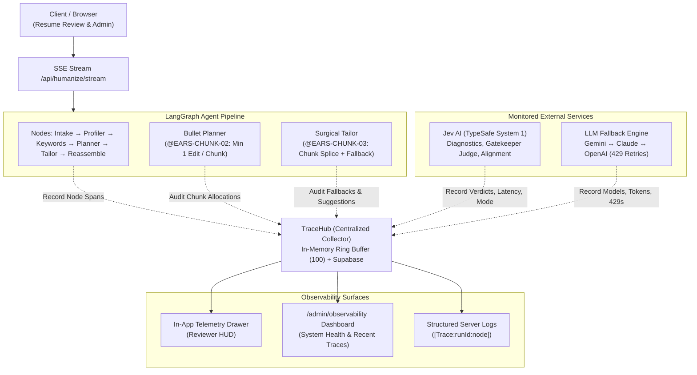

# Application-Wide Observability & Work Experience Chunk Guarantee Design

**Document ID**: SPEC-OBS-2026-09-23  
**Status**: Approved / Ready for Plan & Implementation  
**Target Branch**: `feature/section-narrative-review-flow`  

---

## 1. Executive Summary & Problem Context

As resume tailoring has evolved into an agentic pipeline integrating LangGraph orchestration, multi-model generative LLMs (Gemini, Claude, OpenAI), and TypeSafe AI System 1 (Jev), two primary operational challenges have emerged:

1. **Lack of End-to-End Observability Across the Application**:
   - The interactions with Jev AI, LLM providers (including HTTP 429 rate limit retries and fallback model switches), and LangGraph node durations are scattered across disconnected `console.log` statements.
   - When Jev gatekeeper decisions reject suggestions or fallback to local heuristics due to missing keys or timeouts, neither developers nor users have structured visibility into what occurred, why it occurred, or what latency/tokens were expended.
   - There is no central diagnostic status dashboard or in-app trace inspector to observe system health, provider latency, error rates, and per-step execution details.

2. **Chunk Starvation in Experience Tailoring**:
   - In `minimal` intensity, `pickTopBulletsAcrossJobs` previously selected at most 2 bullets across the entire resume, leaving secondary and foundational jobs with zero candidate edits.
   - Even in `targeted` or `overhaul` modes, if the LLM output yielded non-substantive text or Jev gatekeeper rejected candidate bullets, a job chunk could silently produce 0 suggestions, violating the core user requirement that **every work experience chunk must receive at least one high-quality, authentic recommendation**.

This specification designs a **Unified Application Observability Subsystem** combined with an **Authenticity-Preserving Minimum 1-Edit Per Chunk Guarantee**.

---

## 2. EARS Requirements Specification

Requirements follow the **Easy Approach to Requirements Syntax (EARS)** standards:

### 2.1 Application Observability Requirements (OBS)

* **`@EARS-OBS-01` (Ubiquitous)**:  
  The system SHALL capture every execution lifecycle under a unique `traceId`, recording timestamped spans for all pipeline nodes, external service requests, and quality guard evaluations.

* **`@EARS-OBS-02` (Event-driven)**:  
  WHEN an interaction with Jev AI occurs (`diagnoseChunkWithJev`, `judgeSuggestionWithJev`, `evaluateResumeAlignmentWithJev`), the system SHALL record a `JevSpan` capturing connectivity mode (`live_api` vs `local_fallback`), latency (ms), request ID, token usage, evaluation scores, and gatekeeper verdict (accepted, rejected with rationale, or fallback applied).

* **`@EARS-OBS-03` (Event-driven)**:  
  WHEN an LLM inference call executes through `generateWithFallback`, the system SHALL record an `LLMSpan` capturing the provider, model key, latency, prompt/completion token usage, and any HTTP 429 rate-limit fallback transitions.

* **`@EARS-OBS-04` (State-driven)**:  
  WHILE processing resume requests, the system SHALL maintain the 100 most recent traces in an in-memory circular buffer for instant retrieval, and persist completed traces to Supabase when an authenticated session exists.

* **`@EARS-OBS-05` (Ubiquitous)**:  
  The system SHALL expose structured observability data through three unified surfaces:
  1. An in-app collapsible **"⚡ Observability & Jev Audit"** drawer in the review interface.
  2. A dedicated **`/admin/observability`** dashboard displaying system health, provider latency, error rates, and historical traces.
  3. Structured, filterable server logs formatted as `[Trace:<traceId>:<component>]`.

### 2.2 Work Experience Chunk Guarantee Requirements (CHUNK)

* **`@EARS-CHUNK-01` (Ubiquitous)**:  
  WHEN experience section tailoring is active (`sectionsToModify?.experience !== false`), the system SHALL guarantee that at least one high-quality, authentic suggestion is produced for every work experience chunk in `resumeAST.experience`.

* **`@EARS-CHUNK-02` (State-driven)**:  
  WHILE planning in `minimal` intensity, `bulletPlannerNode` SHALL allocate at least one candidate bullet to every work experience job chunk, selecting the bullet with the highest keyword alignment or impact potential.

* **`@EARS-CHUNK-03` (Event-driven)**:  
  WHEN a work experience chunk yields 0 accepted suggestions after LLM tailoring and Jev evaluation, the system SHALL execute an authenticity-preserving fallback pass on that chunk's primary bullet, elevating opening action verbs without hallucinating facts or metrics, and record a `fallback_applied` audit span in `TraceHub`.

* **`@EARS-CHUNK-04` (Unwanted behavior)**:  
  IF a work experience chunk has no bullet text or empty description, THEN the system SHALL safely record a bypass audit without throwing runtime exceptions.

---

## 3. Architecture & Data Contracts

### 3.1 Architectural Flow Diagram



### 3.2 Data Contracts (`src/app/services/observability/types.ts`)

```typescript
export type SpanType = "node" | "jev" | "llm" | "guard" | "fallback";

export interface JevSpanData {
  operation: "diagnoseChunk" | "judgeSuggestion" | "evaluateAlignment";
  target: string;
  mode: "live_api" | "local_fallback";
  latencyMs: number;
  requestId?: string;
  model?: string;
  tokens?: { prompt?: number; completion?: number; total?: number };
  scores?: {
    isAuthentic?: boolean;
    isBetterThanOriginal?: boolean;
    overallImpactScore?: number;
    toneOfVoiceRating?: string;
    scoreDeltaPercent?: number;
  };
  verdict: "accepted" | "rejected" | "fallback_applied";
  rejectionReason?: string;
}

export interface LLMSpanData {
  provider: "gemini" | "anthropic" | "openai" | "fallback";
  model: string;
  latencyMs: number;
  tokens?: { promptTokens?: number; completionTokens?: number; totalTokens?: number };
  retries: number;
  fallbackTriggered: boolean;
  error?: string;
}

export interface NodeSpanData {
  nodeName: string;
  durationMs: number;
  status: "success" | "error" | "skipped";
  inputSummary?: Record<string, unknown>;
  outputSummary?: Record<string, unknown>;
}

export interface ChunkAuditRecord {
  jobIndex: number;
  company: string;
  role: string;
  originalBulletsCount: number;
  suggestionsCount: number;
  satisfiesMinEdit: boolean;
  appliedFallback: boolean;
  fallbackDetails?: string;
}

export interface TraceRecord {
  traceId: string;
  sessionId?: string;
  userId?: string;
  startTime: string;
  endTime?: string;
  totalDurationMs?: number;
  status: "running" | "completed" | "error";
  error?: string;
  
  // Aggregate Metrics
  jevSummary: {
    totalCalls: number;
    liveCalls: number;
    fallbackCalls: number;
    accepted: number;
    rejected: number;
    avgLatencyMs: number;
  };
  llmSummary: {
    totalCalls: number;
    totalTokens: number;
    fallbacksCount: number;
    avgLatencyMs: number;
  };
  chunkAudits: ChunkAuditRecord[];
  
  // Detailed Spans
  spans: Array<{
    id: string;
    type: SpanType;
    name: string;
    timestamp: string;
    durationMs: number;
    data: JevSpanData | LLMSpanData | NodeSpanData | Record<string, unknown>;
  }>;
}
```

---

## 4. Instrumentation & Subsystem Details

### 4.1 TraceHub Singleton (`src/app/services/observability/traceHub.ts`)

- **State Management**: Implements an in-memory circular ring buffer holding the most recent 100 `TraceRecord` objects.
- **Trace Context**: Maintains active traces keyed by `traceId` with thread-safe append and aggregation helpers.
- **Persistence**: Upon `endTrace`, if an authenticated user session is associated with the trace, the summary and spans are saved into `resumes.improvement_metrics.telemetry`.

### 4.2 Jev AI Telemetry (`src/app/services/jev.ts`)

- Wraps `diagnoseChunkWithJev`, `judgeSuggestionWithJev`, and `evaluateResumeAlignmentWithJev` with high-resolution timers (`performance.now()`).
- Captures API connectivity mode:
  - If `TYPESAFE_API_KEY` is present and request succeeds: `mode: "live_api"`, captures `requestId`, model, token usage, and parsed scores.
  - If API key is missing or request fails/times out: `mode: "local_fallback"`, records fallback reason.
- For suggestion judgments: records gatekeeper verdict (`accepted` vs `rejected`), along with specific rejection rationale (e.g. `"Rejected: suspected hallucination or lack of authenticity (isAuthentic=false)"`).

### 4.3 LLM Provider & Fallback Telemetry (`src/app/services/model-fallback.ts`)

- Intercepts `generateWithFallback` calls.
- Records starting provider/model, execution duration, and token usage.
- If primary model returns 429 or throws, records a fallback transition span documenting the switch to backup models (e.g. Claude 3.5 Sonnet / OpenAI).

### 4.4 Minimum 1-Edit Chunk Guarantee (`bulletPlanner.ts` & `surgicalTailor.ts`)

- **Planner Level**: In `bulletPlanner.ts`, `pickTopBulletsAcrossJobs` ensures every job in `experience` has at least 1 candidate bullet scheduled for tailoring (evaluating keyword gap and recency).
- **Tailor Level**: In `surgicalTailor.ts`, after chunk parsing and Jev evaluation:
  - If a job chunk produces 0 accepted suggestions (due to identical text or Jev rejection):
    - Invokes `createAuthenticChunkFallback(job)` on the primary bullet.
    - Elevates opening weak verbs ("Assisted", "Responsible for") to active leadership verbs ("Engineered", "Orchestrated") from domain taxonomy.
    - Preserves factual scope and metrics without hallucination.
    - Records `fallback_applied` span in `TraceHub`.
  - Verifies `chunkAudit.satisfiesMinEdit = true` for all jobs.

---

## 5. Observability Surfaces & API

### 5.1 In-App Review Drawer (`ResumeSuggestionReviewer.tsx`)
- Adds a sticky telemetry trigger pill: `[ ⚡ Observability & Jev Audit | 12 spans • 1.4s • Jev: Live ]`.
- Slide-over drawer provides:
  1. Live connectivity badge (TypeSafe AI: Active / Local Fallback).
  2. Stage timeline bar with per-node durations.
  3. Work experience chunk audit table showing suggestions per job and fallback statuses.
  4. Jev AI Gatekeeper verdict list (scores, tone, impact, rejection reasons).
  5. "Copy Full Trace JSON" action for instant debugging.

### 5.2 Admin Observability Dashboard (`/admin/observability`)
- Displays real-time health for TypeSafe AI (Jev), LLM providers (429 rate limit counts), and Supabase.
- Table of last 100 traces with filters for errors, status, and latency.
- Detailed waterfall modal for inspecting any specific trace.
- Backed by `/api/observability/traces` (supports list and `?traceId=...` detail).

### 5.3 Structured Server Logs
- Formatted as `[Trace:<traceId>:<component>] <details>` for easy grepping in terminal or CloudWatch/Vercel logs.

---

## 6. Testing & Verification Strategy

### 6.1 Automated Unit & Integration Tests
1. **TraceHub Core (`tests/unit/services/traceHub.test.ts`)**:
   - Verify span recording, aggregate calculations, circular buffer 100-item cap, and trace retrieval.
2. **Jev Observability (`tests/unit/services/jev-observability.test.ts`)**:
   - Verify mode detection (`live_api` vs `local_fallback`), rejection reason recording, and latency tracking.
3. **Chunk Guarantee & Fallback (`tests/unit/agent/chunk-edit-guarantee.test.ts`)**:
   - Verify `bulletPlannerNode` allocates at least 1 bullet per job across 1, 3, and 5-job resumes in `minimal` intensity.
   - Verify authentic fallback activates and provides `suggestionsCount >= 1` when LLM returns duplicate text or Jev rejects all initial suggestions.
4. **Observability API (`tests/unit/api/observability-traces.test.ts`)**:
   - Verify `GET /api/observability/traces` list and detail endpoints.
5. **UI Component (`tests/unit/components/ObservabilityDrawer.test.tsx`)**:
   - Verify telemetry toggle button, drawer opening, metrics display, and chunk audit list.

### 6.2 Regression Verification
- Run complete test suite (`npm test`) across all 82 test suites (584+ tests) with zero regressions.
